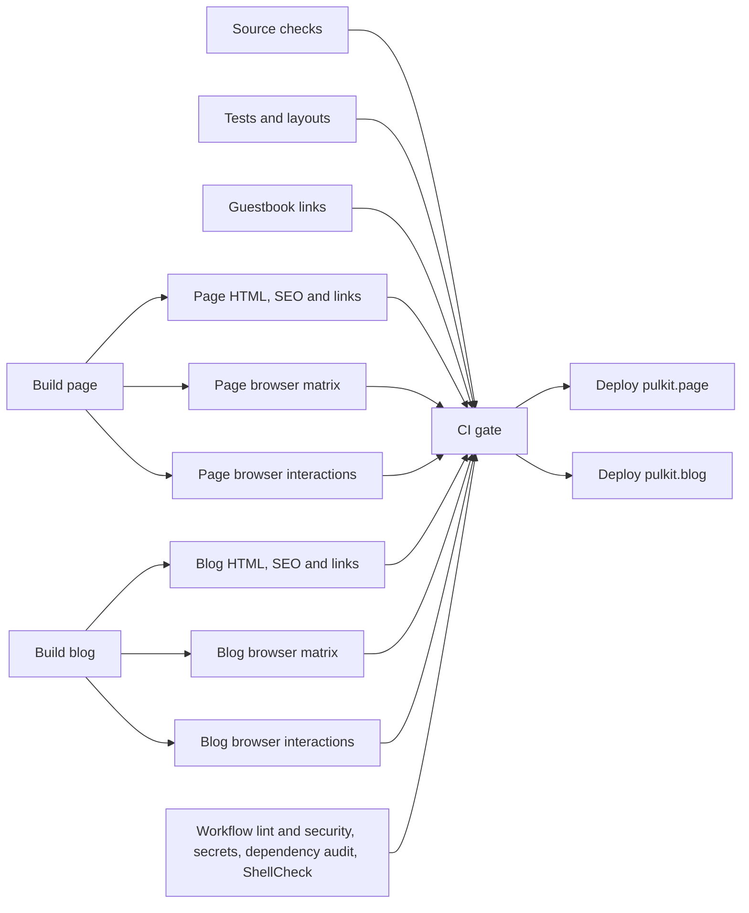

# Continuous integration

[Documentation index](index.md)

[.github/workflows/ci.yml](../.github/workflows/ci.yml) starts independent checks
in parallel and gates both deployments on their combined result. It calls
[site-ci.yml](../.github/workflows/site-ci.yml) once per site, so each site's
browser checks can start as soon as its own build finishes.

## The same checks in three places

| Where               | Command                                                        | Scope                                                          |
| ------------------- | -------------------------------------------------------------- | -------------------------------------------------------------- |
| A working checkout  | `bun run ci`                                                   | The files on disk                                              |
| The pre-commit hook | `bun run ci` inside a copy of the staged index                 | Exactly what the commit would contain                          |
| GitHub Actions      | Parallel source, test, build and site checks, plus CI scanners | The pushed commit, including browser and guestbook link checks |

`bun run ci` is `turbo run verify`. Its three groups are `verify:source`,
`verify:tests`, and `verify:site`. The first two do not build anything; the last
runs HTML, SEO and local reference checks after building each app. Actions runs
these same checks in separate jobs, with `--only` for checks that consume an
already uploaded build.

The [hook](../.githooks/pre-commit) is installed by `bun install` through
[install-hooks.sh](../tooling/checks/install-hooks.sh). It copies the staged index
into a temporary directory, installs dependencies without scripts, and runs
`bun run ci` with `TURBO_CACHE_DIR` pointing at the repository's `.turbo/cache`.
A repair left unstaged still fails. [Scripts and commands](scripts-and-commands.md#staged-snapshot-pre-commit)
describes the hook in detail.

## Triggers and concurrency

The workflow runs on pull requests, merge groups, pushes to `main`, and manual
dispatch. [Sync guestbook](../.github/workflows/guestbook.yml) also calls it with
the revision it published. Every checkout and site build uses that exact revision.

A new pull request or branch run cancels the older run for that ref. Main runs
are isolated by workflow and revision and are allowed to finish. Each deployment
serializes in its own concurrency group and checks the current main revision
before publishing, so a completed run for an older revision skips deployment.

The default permission is `contents: read`. Only the pulkit.page deploy adds
`id-token: write` and `pages: write`. Build secrets go only to site builds.

## The run graph

## The jobs

| Job                       | What it runs                                                                        |
| ------------------------- | ----------------------------------------------------------------------------------- |
| Source checks             | Format, lint, content, comment, repository, import, type, dead code and shell gates |
| Tests and layouts         | Every workspace test suite and the layout checks                                    |
| Guestbook links           | Strict profile link verification with the workflow token                            |
| Site: Build               | One app build, followed immediately by its artifact upload                          |
| Site: HTML, SEO and links | Static validation against that site's uploaded output                               |
| Site: Browser smoke       | Per-site viewport and shard matrix against the same uploaded output                 |
| Workflow lint             | actionlint                                                                          |
| Workflow security         | zizmor, pedantic persona and high minimum severity                                  |
| Secrets                   | gitleaks over the directory                                                         |
| Dependency audit          | `bun audit --audit-level=high`                                                      |
| ShellCheck                | shellcheck on the hook and its installer                                            |
| CI                        | Rejects any failed, cancelled or skipped required job                               |
| Deploy pulkit.page        | Publishes the checked page artifact through GitHub Pages                            |
| Deploy pulkit.blog        | Publishes the checked blog artifact to its own repository                           |

The portfolio uses four page shards per viewport; the smaller blog uses one.
That gives eight portfolio page jobs and two blog page jobs, plus one interaction
job per site.

Neither source checks nor tests delay a build. Site validation and browsers
wait only for their own site's build, and run alongside each other. Browser
matrices use `fail-fast: false`, so a failing shard does not cancel other shards.
The parent site matrix also allows both sites to finish independently.

Each build uploads just its `dist` directory as `built-page` or `built-blog`, with
one day retention and compression disabled for the media-heavy output. Its validation, browsers, and deployment download that same
artifact into `apps/<site>/dist`, with no rebuild and no other site's media.

[check-browser.ts](../packages/engine/src/commands/check-browser.ts) reads
`BROWSER_VIEWPORT`, `BROWSER_SHARD` and `BROWSER_SUITE`. Each shard reads every route for link and
anchor validation, but performs the expensive page assertions only for its
share. With `BROWSER_SUITE=pages`, shards skip whole-site flows. A separate
`BROWSER_SUITE=flows` job runs those once per site alongside page audits: rendering
without JavaScript, theme persistence, blocked storage, keyboard navigation and
view transitions. Local runs default to `BROWSER_SUITE=all`, which runs page
audits and includes flows in the last mobile shard. `PLAYWRIGHT_CHANNEL=chrome` reuses the runner's Chrome.

The final `CI` job always runs and requires every upstream result to be
`success`. Both deploy jobs depend on it and run only on main for pushes or
manual dispatches. The scheduled guestbook workflow can also deploy pulkit.page
after its published revision passes. See [deployment](deployment.md).

## Pinning, timeouts and the policy tests

Every external action is pinned to a 40 character commit SHA. Every runner job
sets `timeout-minutes`. [policy-ci.test.ts](../tooling/checks/src/commands/policy-ci.test.ts)
checks those constraints, revision propagation, the dependency graph, artifact
reuse and deployment conditions. It executes the gate with successful, failed,
cancelled and skipped results to verify that only success permits deployment.
It also checks that every local check, lint, format and test script is reachable
from `verify` or named in a workflow.

Bun is pinned to 1.4.2. Runner jobs use `ubuntu-26.04`, registered in
[.github/actionlint.yaml](../.github/actionlint.yaml).

## Caches in CI

Every Bun job restores `~/.bun/install/cache` keyed on `bun.lock`. Source checks,
tests, and each site's build have separate Turbo cache namespaces, so concurrent
jobs do not overwrite each other's cache. Build jobs also restore their site's
`apps/<site>/.cache/generate` and `.cache/responsive-images`. Responsive variants
are content-addressed, so source image edits generate new variants while unchanged
images reuse previous work. Build cache prefixes include the lockfile and image
optimizer source hash to invalidate variants when their implementation or
dependencies change. Keys end with the requested revision; restore prefixes stay
scoped to the group or site. Builds prune week-old Turbo entries before saving their cache.
See [architecture](architecture.md#three-layers-of-caching).

Engine tests keep their 30 second timeout for initial Shiki grammar and Biome
WebAssembly loading. They have a separate runner from builds in Actions.

## What CI does not establish

The workflow proves that the committed sources build and pass every local gate,
and that the built output survives a browser audit. It does not verify DNS, Pages
settings, branch protection, environment approvals, external links, or that any
tutorial is still technically correct. See [quality checks](quality-checks.md).
